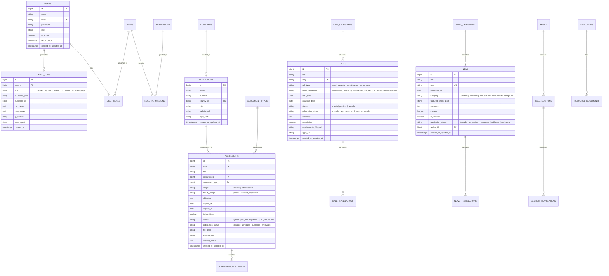

# Arquitectura de Software y Sistema de Diseño — Portal & Intranet OGI UNALM

**Proyecto:** Modernización Integral del Portal Web e Intranet OGI  
**Entorno de ejecución:** Windows Server / IIS + PHP 8.3.35 + MySQL (`172.16.0.189`)  
**Ruta pública:** `https://www.lamolina.edu.pe/pruebas1/david/OGI/`  

---

## 1. Diagrama de Módulos del Sistema

```mermaid
graph TD
    subgraph "Portal Público (Blade SSR + Tailwind CSS)"
        P1[Inicio / Portada Dinámica]
        P2[La OGI: Presentación / Misión / Visión / Equipo]
        P3[Convenios: Directorio Nacional e Internacional con Filtros]
        P4[Movilidad Académica: Entrante y Saliente]
        P5[Becas y Convocatorias: Abiertas / Próximas / Históricas]
        P6[Noticias, Eventos y Experiencias]
        P7[Recursos y Documentos Oficiales]
        P8[Contacto Institucional]
    end

    subgraph "Servicios Transversales"
        ST1[Selector Bilingüe ES / EN con persistencia]
        ST2[Control de Tema Claro / Oscuro con Tokens CSS]
        ST3[Navegación Sticky Accesible con Blur y Reducción de Movimiento]
        ST4[SEO Técnico: Metadatos OpenGraph, Canónicos y Sitemap]
    end

    subgraph "Intranet Administrativa / CMS (/intranet o /admin)"
        A1[Autenticación Segura y Control de Sesión]
        A2[Gestión RBAC: Roles y Permisos Granulares]
        A3[Gestor de Convenios y Documentos PDF]
        A4[Gestor de Convocatorias y Oportunidades]
        A5[Gestor de Noticias, Eventos y Portada]
        A6[Gestor de Movilidad y Guías de Intercambio]
        A7[Biblioteca de Medios Segura]
        A8[Trazabilidad y Logs de Auditoría]
        A9[Gestión de Estados Editoriales y Traducciones]
    end

    subgraph "Capa de Datos (MySQL - ogi_web @ 172.16.0.189)"
        DB[(Base de Datos MySQL)]
    end

    P1 & P2 & P3 & P4 & P5 & P6 & P7 & P8 --> ST1 & ST2 & ST3 & ST4
    A1 & A2 & A3 & A4 & A5 & A6 & A7 & A8 & A9 --> DB
    P1 & P2 & P3 & P4 & P5 & P6 & P7 & P8 --> DB
```

---

## 2. Modelo Relacional de Base de Datos (ERD)

---

## 3. Matriz de Roles y Permisos (RBAC)

| Módulo / Acción | Superadministrador | Administrador OGI | Editor | Revisor | Publicador | Consulta |
|---|:---:|:---:|:---:|:---:|:---:|:---:|
| **Gestión de Usuarios y Roles** | Total | Solo lectura | Sin acceso | Sin acceso | Sin acceso | Sin acceso |
| **Convenios: Crear / Editar borrador** | Sí | Sí | Sí | No | No | No |
| **Convenios: Revisar / Observar** | Sí | Sí | No | Sí | Sí | Solo lectura |
| **Convenios: Publicar / Despublicar** | Sí | Sí | No | No | Sí | No |
| **Convocatorias y Becas: Publicar** | Sí | Sí | No | No | Sí | No |
| **Noticias y Portada: Modificar** | Sí | Sí | Sí | No | Sí | No |
| **Subida de Archivos y Medios** | Sí | Sí | Sí | No | Sí | No |
| **Ver Logs de Auditoría** | Sí | Sí | No | No | No | Solo lectura |

---

## 4. Sistema de Diseño Visual Institucional (Tokens UNALM)

### 4.1 Paleta Cromática Institucional
- **Verde Molinero Principal:** `#0F5132` (RGB 15, 81, 50) — Color oficial de la UNALM, representa el carácter agropecuario, forestal y científico de la universidad.
- **Verde Bosque Profundo (Dark Mode Accent):** `#198754` y `#20c997`
- **Dorado / Acento Cálido Molinero:** `#D4AF37` / `#C59B27` — Utilizado para insignias, acreditaciones de excelencia y destacados.
- **Neutro Claro (Fondo Light Mode):** `#F8F9FA` y `#FFFFFF`
- **Neutro Carbón (Fondo Dark Mode):** `#0E1712` y `#16241D` — Tono oscuro con matiz vegetal para mantener la identidad aún en modo nocturno.
- **Bordes y Superficies:** Diseñados con ratios de contraste WCAG AA (> 4.5:1 para texto regular, > 3:1 para componentes de interfaz).

### 4.2 Tipografía
- **Titulares:** *Outfit* o *Inter* de alta legibilidad editorial con pesos 600 y 700.
- **Cuerpo de texto:** *Inter* / *system-ui* con interlineado generoso (1.6) y espaciado de párrafos accesible.

### 4.3 Navegación Sticky y Transición Hero
- **En la cabecera del Hero:** Barra con transparencia y desenfoque suave (*backdrop-blur*), permitiendo visualización inmersiva de la identidad visual.
- **Al hacer scroll hacia abajo:** Transición suave (*cubic-bezier*) a barra sólida, con sombra sutil y contraste absoluto.
- **Accesibilidad móvil:** Menú tipo cajón con foco atrapado (*focus trap*), soporte para teclado (Escape para cerrar, Tab para navegar) y control de bloqueo de scroll del cuerpo.

---

## 5. Estrategia de Subdirectorio `/pruebas1/david/OGI/`

Dado que la aplicación se ejecuta dentro del subdirectorio `https://www.lamolina.edu.pe/pruebas1/david/OGI/`:
1. `APP_URL` configurado en `https://www.lamolina.edu.pe/pruebas1/david/OGI/public`.
2. Archivo `index.php` raíz configurado con redirección inteligente hacia `/public/` o reescritura directa.
3. Reglas de IIS en `web.config` raíz y `public/web.config` para enrutar todas las solicitudes a `public/index.php`.
4. Enlaces generados con helpers de Laravel (`route()`, `asset()`, `url()`) para garantizar que todas las URLs incluyan automáticamente el prefijo de subcarpeta sin rutas rotas.
